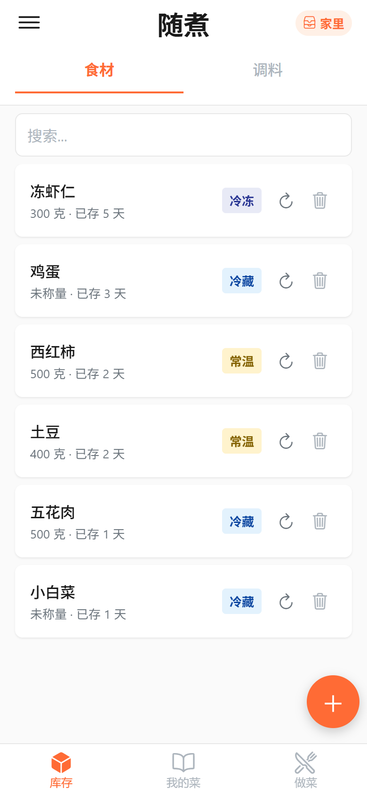
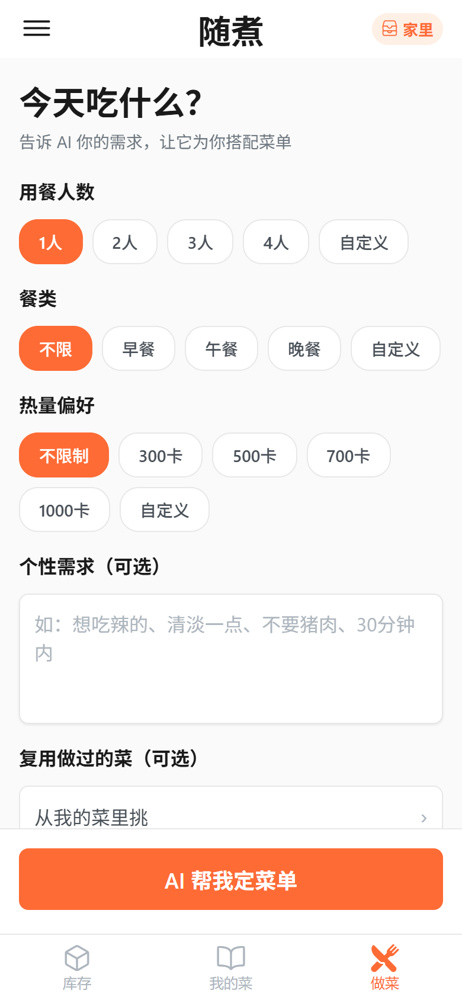
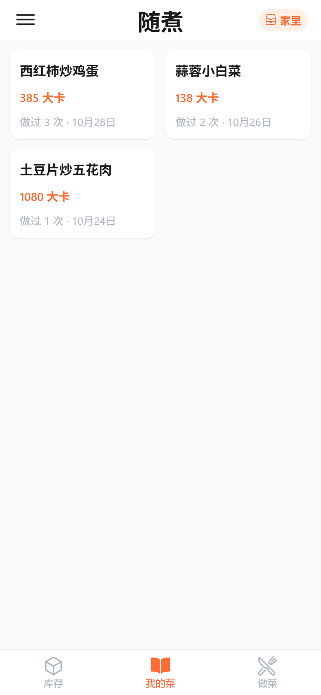
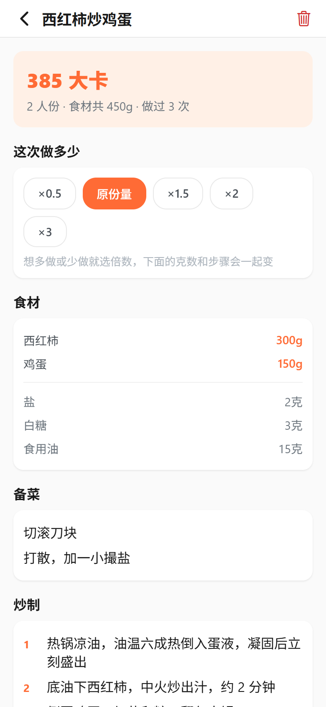

# SmartCook (随煮)

> Turn whatever is already in your fridge into a complete meal — then cook it, step by step.

SmartCook is a React Native (Expo) cooking app. It reads your fridge inventory, asks three questions (people, meal, calorie target), and streams back a **whole menu** — several dishes that share the ingredients you own, with nutrition, a shopping list for what is missing, prep steps, and cooking steps. Then it walks you through the kitchen with a pager you can leave and resume.

No backend, no account, no tracking. All data stays on the device, and the AI is called directly from the app with **your own API key**.

<table>
  <tr>
    <td></td>
    <td></td>
    <td></td>
    <td></td>
  </tr>
  <tr>
    <td align="center"><sub>Inventory, with storage state</sub></td>
    <td align="center"><sub>Ask the AI for a menu</sub></td>
    <td align="center"><sub>Dishes you have cooked</sub></td>
    <td align="center"><sub>Scale, prep, cook</sub></td>
  </tr>
</table>

## Download

**[⬇ Download the latest APK](https://github.com/citoufav/smart-cook/releases/latest)** (Android 7.0+, arm64)

- Signed with a debug key: it installs over a previous build and keeps your data, but it is not store-ready.
- Allow "install unknown apps" for your browser or file manager when prompted.
- GitHub release downloads can be slow or blocked in mainland China. See [Distribution](#distribution).

## 中文简介

随煮是一款「用你冰箱里现有的东西，一次给你整桌菜，并带你做完」的做饭应用。

打开就能看到库存里有什么（可手动录入，也可以拍一张照片让 AI 认）；选好人数、餐类和热量偏好，AI 会一次性给你几道菜搭配好的一桌饭 —— 谁先做、缺什么要买、每道菜放多少克、备菜和炒制分几步，全都有。做饭时是一页一页翻着走的，中途退出去，下次回来还能接着做。

所有数据只存在手机本地，AI 用你自己的 API Key 直连，没有服务器、不用注册。

## Why this exists

I wanted to learn cooking. Recipes on the internet assume you have everything; they also assume you will read a 2000-word wall of text while holding a knife. So the app starts from what is actually in the fridge, produces a menu that fits it, and then becomes a step-by-step guide in the kitchen.

## Features

**The core loop — inventory → menu → cook**

- **Whole-menu generation** — one request produces several dishes that fit the inventory together, not one recipe at a time: shared ingredients, a suggested cooking order, per-dish nutrition, and a shopping list for the gaps.
- **Streamed, with reasoning** — responses stream over SSE; the model's reasoning is shown while it thinks. Retry with exponential backoff, request timeouts, and a loop detector that stops a reasoning chain repeating itself forever.
- **Three-stage cooking** — Menu → Prep → Cooking in a swipeable pager. Progress is persisted per step, so an interrupted dinner resumes where it stopped.
- **Recipe chat** — ask questions about the menu, or let the AI modify ingredients and steps through a tool call. Every edit is shown for confirm/cancel before it lands.

**Inventory**

- **Photo recognition** — point the camera at the fridge; the model returns ingredient *and* seasoning names, classified. Nothing is written until you confirm the list, and weights are left empty on purpose (a photo cannot show grams).
- **Storage state per ingredient** — 常温 / 冷藏 / 冷冻, one tap to cycle. It scales the shelf-life warnings (×0.6 / ×1 / ×15) and is sent to the model, so it knows the pork is frozen.
- **Shelf-life warnings** — age plus food type against a local table; it warns and never reassures. It never blocks a menu and never claims food is still good.
- **Profiles** — separate inventories for home and office; dishes and settings stay shared.
- **Seasoning status** — 够 / 少 / 没了, not just names.
- **Import / export** — one JSON file for everything, merge-based, nothing overwritten by a same-named entry.

**Retention**

- **My dishes** — every cooked dish lands in a library. Pick from it next time and the AI only decides portions and what is missing.
- **Dietary memory** — recently cooked dishes are remembered so the same dinner does not come back tomorrow.
- **Nutrition** — per dish and per meal, from `kcalPer100g` densities so it follows edits (change the grams, the calories move with it).

## How it works

```
inventory + preferences
        │
        ├─ build prompt (inventory lines, dietary tags, health rules, skill level)
        ▼
   POST /chat/completions (OpenAI-compatible)  or  /v1/messages (Anthropic)
        │  SSE stream: reasoning + JSON body
        ▼
   Zod-validated MenuProposal  ──►  Menu / Prep / Cooking pager
        │
        ├─► shopping list (missing items)
        ├─► dish library (saved on completion)
        └─► nutrition (recomputed locally from grams × kcalPer100g)
```

Only two AI protocols are supported, and both live in one place (`src/utils/aiRequest.ts`, `src/services/aiClient.ts`):

| Protocol | Endpoint | Auth |
|---|---|---|
| OpenAI-compatible (default, DeepSeek) | `POST /chat/completions` | `Authorization: Bearer` |
| Anthropic-compatible | `POST /v1/messages` | `x-api-key` + `anthropic-version` |

Model name and base URL are user-editable, so Kimi / Zhipu / Qwen / OpenRouter / local Ollama all work through the OpenAI-compatible preset. Images (photo recognition) are sent inline as base64 `image_url` blocks for OpenAI-compatible endpoints and as `image` + `source.base64` blocks for Anthropic — the protocol difference is mapped in one pure function.

## Tech stack

| Category | Technology |
|---|---|
| Framework | Expo SDK 54 · React Native 0.81 · React 19 · Hermes · new architecture |
| Language | TypeScript (strict-ish, `tsc --noEmit` clean) |
| Routing | Expo Router (file-based) |
| State | React Context + `useReducer` |
| Storage | AsyncStorage (data) · SecureStore (API key) |
| AI | DeepSeek / OpenAI-compatible / Anthropic-compatible, streamed over SSE |
| Validation | Zod |
| Camera | expo-image-picker |

## Architecture

Four layers, one direction:

```
app/            routing + screens (Expo Router)
  ↓
src/components/ presentational components (sheets, pager, drawers)
  ↓
src/contexts/   state (React Context + useReducer)
  ↓
src/services/   business logic, AI, storage
  ↓
src/utils/      pure helpers (no UI, no React)
```

Pure logic deliberately lives in files with **no runtime imports** (`shelfLife`, `menuEditService`, `dishLibrary`, `backupFormat`, `aiRequest`, `visionParse`, …) so it can be executed by plain Node in the self-checks below.

## Self-checks

No test framework — seven assertion scripts, each pinning the logic that is otherwise expensive to verify by hand (protocol shapes, merge rules, shelf-life boundaries, AI output parsing):

```bash
npm run typecheck     # tsc --noEmit
npm run check:ai      # request body per protocol (OpenAI vs Anthropic)
npm run check:vision  # photo-recognition parsing + image block shapes
npm run check:edits   # menu edits, scaling, nutrition recompute, format samples
npm run check:dishes  # dish-library merge rules
npm run check:backup  # backup format + import merge
npm run check:tags    # ingredient tag parsing and colours
npm run check:meal    # next-meal time + shelf life (storage multipliers)
```

## Getting started

```bash
npm install
npx expo start          # scan the QR with Expo Go, or press w for web
```

### Bring your own key

Settings → paste an API key.

- DeepSeek (default): `https://api.deepseek.com`, model `deepseek-flash`, key from [platform.deepseek.com](https://platform.deepseek.com)
- Any OpenAI-compatible endpoint: fill in base URL and model name
- Anthropic-compatible: `https://api.anthropic.com` + `claude-sonnet-4-5` (or DeepSeek's Anthropic-compatible endpoint)

The key is stored with `expo-secure-store` when available and sent only to the endpoint you configured. Without a key the app still runs — everything except menu generation works.

## Building the Android APK

Local release build (what the releases are built with):

```bash
npx expo prebuild --platform android            # generates android/ (gitignored, CNG workflow)
cd android && ./gradlew assembleRelease        # → android/app/build/outputs/apk/release/app-release.apk
```

Or with EAS:

```bash
npx eas build --platform android --profile preview
```

iOS needs macOS + Xcode or EAS cloud build; there is no local Windows path.

## Distribution

Releases are published as APK assets on GitHub. GitHub release downloads are unreliable in mainland China, so a mirror (Gitee release or a static landing page) is the intended domestic path. The APK is never committed to the repository.

## Project structure

```
SmartCook_demo/
├── app/                        # Expo Router screens
│   ├── (tabs)/                 # inventory · my dishes · cooking entry
│   ├── cooking/                # menu / prep / cooking pager, shopping list, inventory update
│   ├── dish/[id].tsx           # saved-dish detail
│   └── onboard.tsx             # first-run onboarding (bring your own key)
├── src/
│   ├── components/             # sheets, pager, progress bar, alert, settings drawer
│   ├── contexts/               # inventory · cooking · settings · nutrition
│   ├── services/               # AI, vision, storage, backup, dish library, progress
│   ├── utils/                  # pure logic: aiRequest, shelfLife, menuEdit, visionParse, …
│   ├── constants/              # colors, spacing, typography, providers, prompts
│   └── types/
├── scripts/                    # self-checks (check-*.mjs)
├── docs/
│   ├── CHANGELOG.md            # decision log: what changed and why
│   ├── BACKLOG.md
│   └── screenshots/
├── app.json
└── package.json
```

## Development records

Every feature and every deliberate non-feature is written down in [docs/CHANGELOG.md](docs/CHANGELOG.md) — including what was rejected and why. That file is the project's memory: it is how a decision made three months ago still makes sense today.

Open work and known gaps: [docs/BACKLOG.md](docs/BACKLOG.md).

## About

Built as a personal project and developed with AI-assisted coding tools (Trae IDE). Pre-release: expect rough edges. Feedback and issues are welcome.

## License

[MIT](LICENSE) © citoufav
